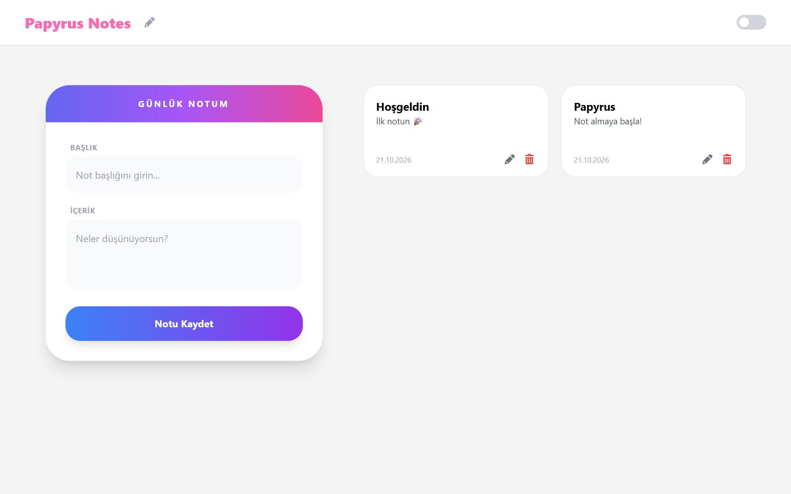
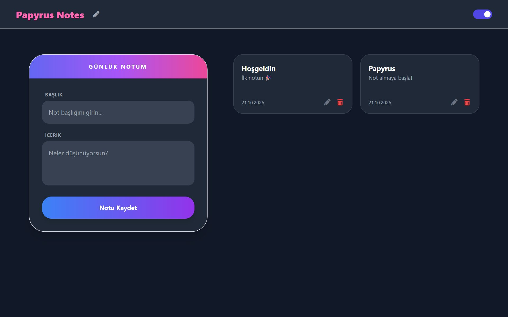

<div align="center">

# Papyrus Notes

**A clean note-taking app with light and dark themes, built with React and Tailwind CSS.**


### [▶ Live demo](https://merry-zuccutto-7c1917.netlify.app/)



</div>

## Features

- **Create notes** with a title and content; empty notes are rejected with a warning
- **Edit in place**: a note card turns into an editable form and saves on confirm
- **Delete** notes with one click
- **Saved automatically** in the browser's `localStorage`, so notes survive a page refresh
- **Light and dark themes** with a toggle; the choice is remembered between visits
- **Dated cards**: each note shows the day it was created
- **Starter notes** on the first visit so the board is never empty

<div align="center">

</div>

## How it works

Note logic lives in a small `NoteManager` class (`src/interfaces/NoteInterface.js`) that keeps the list in memory and writes it to `localStorage` after every change. The React components only call `add`, `update` and `delete`, so the storage layer could be swapped for an API without touching the UI.

```
Home.jsx  ──►  NoteManager  ──►  localStorage
   │
   ├── NoteForm.jsx     create a note
   ├── NoteCard.jsx     show, edit and delete a note
   └── ThemeToggle.jsx  switch between light and dark
```

## Tech stack

| | |
|---|---|
| UI | React 19, React Icons |
| Styling | Tailwind CSS 3 with class-based dark mode |
| Storage | Browser `localStorage` |
| Tooling | Create React App, React Testing Library |
| Hosting | Netlify |

## Getting started

```bash
git clone https://github.com/eceboylu/my-notes-app.git
cd my-notes-app
npm install
npm start
```

The app opens at http://localhost:3000.

| Command | Description |
|---|---|
| `npm start` | Start the development server |
| `npm run build` | Create a production build in `build/` |
| `npm test` | Run the tests |

## Project structure

```
src/
├── pages/Home.jsx              Page layout and note list
├── components/
│   ├── NoteForm.jsx            New note form
│   ├── NoteCard.jsx            Note card with edit and delete
│   └── ThemeToggle.jsx         Light / dark switch
├── interfaces/NoteInterface.js Note model and storage manager
└── index.js                    App entry, restores the saved theme
```
